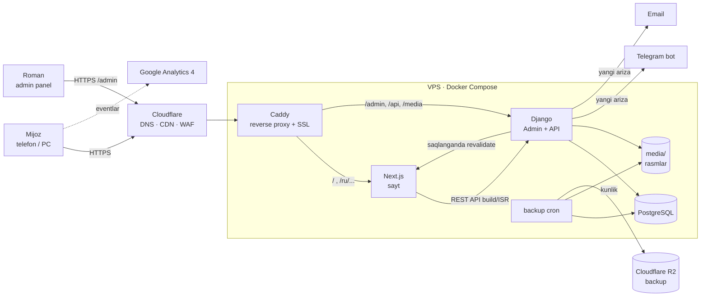

# 01 · Arxitektura

## 1. Texnologiyalar (stack)

Yozishmada aytilgan arxitektura: **Next.js + Django + PostgreSQL**, VPS'da.

| Qatlam | Texnologiya | Nima uchun |
|---|---|---|
| Frontend (sayt) | **Next.js** (App Router, TypeScript) | SSG/ISR: sahifalar oldindan HTML qilib yig'iladi, shuning uchun tez yuklanadi va SEO uchun qulay. Rasm optimizatsiyasi va i18n routing ham bor. |
| Stillar | **Tailwind CSS** + CSS variables (design tokens) | Tez ishlash, 3 ta vizual yo'nalishni tokenlar orqali almashtirish oson |
| i18n | **next-intl** | `/en`, `/ru` marshrutlari va hreflang |
| Backend + Admin | **Django 5.2 LTS** (aprel 2028 gacha qo'llab-quvvatlanadi) | Tayyor, ishonchli **admin panel**. Uzoq qo'llab-quvvatlash muddati texnik xizmatni kamaytiradi. |
| Admin UI | **django-unfold** | Zamonaviy va chiroyli admin interfeysi, mobilda ham ishlaydi. Roman texnik odam emas, shuning uchun bu muhim. |
| Tarjima maydonlari | **django-modeltranslation** | Har bir matn maydoni `_en` va `_ru` bo'ladi, adminda tab ko'rinishida |
| API | **Django REST Framework** | Frontend ma'lumotni shu yerdan oladi |
| Saralash | **django-admin-sortable2** | Paketlar, rasmlar va bloklar tartibini drag & drop bilan o'zgartirish |
| Rasmlar | **Pillow** + yuklashda WebP/AVIF variantlar (480/960/1600/2400 px) | Galereya saytni sekinlashtirmasligi uchun |
| Ma'lumotlar bazasi | **PostgreSQL 16** | Ishonchli, bepul |
| Web server / SSL | **Caddy** (reverse proxy) | Sozlash oddiy, SSL avtomatik |
| CDN / himoya | **Cloudflare** (bepul tarif) | Kesh, DDoS himoyasi, DNS, Turnstile (spamga qarshi) |
| Konteynerlar | **Docker Compose** | Bitta buyruq bilan ishga tushiriladi va ko'chiriladi |
| CI/CD | **GitHub Actions** | `main` branch'ga push bo'lganda avtomatik deploy |
| Backup | `pg_dump` + media → **Cloudflare R2** (10 GB gacha bepul) | Backup serverdan tashqarida saqlanadi |
| Bildirishnomalar | Email (SMTP yoki Resend) + **Telegram bot** (bepul) | Yangi ariza haqida darhol xabar beradi |
| Monitoring | **UptimeRobot** (bepul) + Sentry (bepul tarif, ixtiyoriy) | Sayt ishlamay qolsa xabar beradi |

## 2. Tizim sxemasi



### Ma'lumot oqimi

1. **Roman adminda o'zgartiradi**, masalan paket narxini. Django saqlaydi va Next.js'ga `revalidate` webhook yuboradi. Sahifa 1–2 soniyada yangilanadi. Qayta build qilish kerak emas.
2. **Mijoz saytni ochadi.** Sahifa tayyor HTML ko'rinishida Cloudflare keshidan keladi, juda tez.
3. **Mijoz ariza yuboradi.** Next.js uni Django API'ga yuboradi. Django arizani bazaga yozadi, Telegram va email'ga xabar jo'natadi, mijoz `/thank-you` sahifasiga o'tadi. Bu GA4'da konversiya sifatida qayd etiladi.
4. **Mijoz WhatsApp'ni bosadi.** GA4 eventi yuboriladi. `wa.me` havolasida qaysi sahifadan kelgani yozilgan tayyor matn bo'ladi.

## 3. Repo tuzilmasi (reja)

```
rokate-catering/
├── frontend/                         # Next.js
│   ├── app/
│   │   └── [locale]/                 # en | ru
│   │       ├── page.tsx              # Bosh sahifa
│   │       ├── catering/[slug]/      # Xizmat sahifalari (CMS'dan)
│   │       ├── packages/             # Tayyor paketlar
│   │       ├── menu/                 # Menyu
│   │       ├── portfolio/            # Portfolio ro'yxati
│   │       ├── portfolio/[slug]/     # Portfolio loyihasi
│   │       ├── partners/             # Hamkorlar
│   │       ├── contact/              # Kontaktlar + forma
│   │       ├── thank-you/            # Konversiya sahifasi
│   │       └── privacy/              # Maxfiylik siyosati
│   ├── components/
│   │   ├── layout/                   # Header, Footer, MobileBar
│   │   ├── sections/                 # Hero, About, Services, Packages, Portfolio, WeWorkYouRelax, WhyUs, CTA...
│   │   ├── ui/                       # Button, Card, Gallery, Lightbox, Form fields
│   │   └── forms/                    # InquiryForm, PartnerForm
│   ├── lib/
│   │   ├── api.ts                    # Django API client
│   │   ├── analytics.ts              # GA4 eventlari
│   │   ├── seo.ts                    # metadata, JSON-LD
│   │   └── whatsapp.ts               # wa.me havola generatori
│   ├── messages/                     # en.json, ru.json (statik UI matnlari)
│   ├── styles/tokens.css             # Design tokens
│   └── app/api/revalidate/route.ts   # Django'dan keladigan webhook
│
├── backend/                          # Django
│   ├── config/                       # settings (base/dev/prod), urls, wsgi
│   ├── apps/
│   │   ├── core/                     # SiteSettings, HomePage, FAQ, AdditionalService
│   │   ├── services/                 # ServicePage (xizmat sahifalari), EventType
│   │   ├── catering/                 # CateringPackage, SeasonalOffer, Menu
│   │   ├── portfolio/                # PortfolioProject, PortfolioImage
│   │   ├── leads/                    # Inquiry, PartnerRequest, bildirishnomalar
│   │   └── media_tools/              # Rasm variantlari (WebP/AVIF), validatsiya
│   ├── templates/admin/              # Admin dashboard moslashtirish
│   └── manage.py
│
├── infra/
│   ├── docker-compose.yml
│   ├── docker-compose.dev.yml
│   ├── Caddyfile
│   ├── backup/                       # pg_dump + rclone → R2
│   └── .env.example
│
├── docs/                             # Shu hujjatlar
├── materials/                        # Mijoz materiallari
└── .github/workflows/deploy.yml
```

## 4. Muhitlar

| Muhit | Qayerda | Maqsad |
|---|---|---|
| `dev` | Lokal kompyuter, `docker-compose.dev.yml` | Ishlab chiqish |
| `staging` | Shu VPS, `staging.<domen>`, parol bilan yopiq | Romanga oldindan ko'rsatish (ixtiyoriy) |
| `prod` | VPS, `<domen>` | Jonli sayt |

## 5. Xavfsizlik

- Admin `/admin` yo'lida emas, maxfiy yo'lda bo'ladi, masalan `/manage-rk/`. Kuchli parol, **2FA** (django-otp) va loginga urinishlar soni cheklangan (django-axes).
- Formalarda **Cloudflare Turnstile**, honeypot maydon va rate limit.
- VPS'da faqat SSH kalit bilan kirish, `ufw` (faqat 80/443/22 portlar), `unattended-upgrades` (avtomatik xavfsizlik yangilanishlari).
- Barcha maxfiy kalitlar `.env` faylida turadi, repo'ga tushmaydi.
- Ma'lumotlar bazasi tashqaridan yopiq, faqat Docker tarmog'i ichida ishlaydi.

## 6. Arxitektura qarorlari (ADR)

### ADR-1. Nega Next.js + Django, Tilda emas?
Roman o'zgartirishlarni o'zi qilishni, ko'p tilni, alohida SEO sahifalarni, paket va portfolio boshqaruvini va konversiya analitikasini so'ragan. Tilda'da bular qisman bor, lekin narxi oshadi (Business tarif) va moslashuvchanlik cheklanadi. Bizning yechimda **egalik to'liq Romanda**, yillik xarajat esa Tilda bilan taxminan bir xil (qarang [08](08-infratuzilma-va-xarajatlar.md)).

### ADR-2. Muqobil variant: soddalashtirilgan monolit (⚠️ qaror kutilmoqda)
Yozishmada "agar oddiyroq yechim topsam, taklif qilaman" deyilgan. Muqobil: **faqat Django** (server-rendered shablonlar + Tailwind + Alpine.js), Next.js'siz.

| | Next.js + Django | Faqat Django |
|---|---|---|
| Sahifa tezligi | ⭐⭐⭐⭐⭐ (SSG + CDN) | ⭐⭐⭐⭐ (Cloudflare kesh bilan) |
| Animatsiyalar (Modern Dynamic) | Oson | Mumkin, biroz qiyinroq |
| Texnik xizmat | 2 ta ilova (Node + Python) | 1 ta ilova, sodda |
| Server resursi | ~2 GB RAM | ~1 GB RAM |
| Ishlab chiqish vaqti | Ko'proq | Kamroq |

**Tavsiya:** asosiy reja **Next.js + Django**, chunki Romanga shu aytilgan. Agar Roman "Premium Minimal" yo'nalishini tanlasa va texnik xizmatning soddaligi muhimroq bo'lsa, monolit variantini qayta ko'rib chiqish mumkin. Bu qarorni siz qabul qilasiz.

### ADR-3. Nega Wagtail emas, Django Admin + Unfold?
Wagtail kuchli CMS, lekin bu loyiha uchun ortiqcha. Saytda erkin sahifa konstruktori kerak emas, tuzilgan kontent kerak: paketlar, portfolio, takliflar. Django Admin + Unfold yengilroq, tushunarliroq va yangilashda muammosiz.

### ADR-4. Kontent modeli: tuzilgan, "page builder" emas
Roman dizaynni buzib qo'ya olmasligi kerak. U faqat **ma'lumotni** o'zgartiradi: matn, rasm, narx, tartib, ko'rsatish yoki yashirish. Bloklar joylashuvi kodda qat'iy belgilanadi. Bu premium ko'rinishni saqlab qoladi.

### ADR-5. Xizmat sahifalari — CMS'dagi yozuvlar
`/catering/yacht-catering` kabi sahifalar kodda emas, admindagi `ServicePage` yozuvlari bo'ladi. Roman kelajakda yangi yo'nalish qo'shmoqchi bo'lsa (masalan, Desert Catering), dasturchisiz qo'shadi. Bu Romanning "масштабируемость" talabiga javob beradi.
