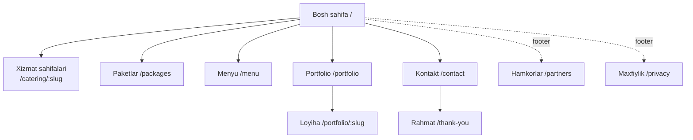

# 02 · Sahifalar va tuzilma

## 1. Sitemap

## 2. URL va til sxemasi

- Ingliz tili — **asosiy**, prefikssiz: `rokate.../packages`
- Rus tili: `rokate.../ru/packages`
- Har sahifada `hreflang="en"`, `hreflang="ru"` va `x-default` bo'ladi.
- Header'da til almashtirgich bor. Til almashtirilganda foydalanuvchi o'sha sahifaning tarjimasiga o'tadi.
- Slug'lar ikkala tilda ham inglizcha bo'ladi (`/ru/catering/yacht-catering`). Bu soddaroq va SEO'ga zarar qilmaydi.

## 3. 1-bosqich (MVP) sahifalari

| Sahifa | URL | Kim boshqaradi |
|---|---|---|
| Bosh sahifa | `/` | Admin: HomePage + bog'langan yozuvlar |
| Xizmat sahifalari (2–4 ta, kontentga qarab) | `/catering/<slug>` | Admin: ServicePage |
| Tayyor paketlar | `/packages` | Admin: CateringPackage |
| Menyu | `/menu` | Admin: Menu (ro'yxat + PDF) |
| Portfolio | `/portfolio` | Admin: PortfolioProject |
| Portfolio loyihasi | `/portfolio/<slug>` | Admin: PortfolioProject |
| Kontakt + ariza | `/contact` | Admin: SiteSettings |
| Rahmat | `/thank-you` | Statik (GA4 konversiyasi) |
| Hamkorlar | `/partners` | Admin: PartnersPage |
| Maxfiylik siyosati | `/privacy` | Admin: oddiy matn |
| 404 | — | Statik |

**Xizmat sahifalari uchun nomzodlar** (Instagram kontenti ko'rilgandan keyin aniqlanadi):

| Sahifa | Kontent bormi? (arxiv bo'yicha) |
|---|---|
| Yacht Catering | ✅ Juda ko'p: 15+ surat |
| Private Events & Birthdays (villa, uy) | ✅ Bor: tug'ilgan kun yaxtada, villa kechki ziyofati |
| Corporate & Office Catering | 🟡 Kam: 1–2 surat (ofis fourshet) |
| Villa Catering | 🟡 Kam: 1 surat (tungi villa) |
| Desert / Outdoor | 🟡 Pyramid Box piknik surati |

Tavsiya: boshida **Yacht Catering** va **Private Events** alohida sahifa bo'ladi. **Corporate** kontent yetarli bo'lsa qo'shiladi. Qolganlari bosh sahifada kartochka sifatida turadi, keyin admindan sahifa qilib qo'shiladi.

## 4. Bosh sahifa: bloklar

Romanning ketma-ketligi va sizning tuzatishingiz asosida:

| # | Blok | Mazmun | CTA |
|---|---|---|---|
| 1 | **Hero** | Katta surat yoki qisqa video (yaxta + dasturxon). Sarlavha: *"Premium catering for yachts, villas & events in Dubai"*. Qisqa izoh. | `Get a proposal` · `WhatsApp` |
| 2 | **Biz kimmiz** | 2–3 jumla: Rokate shunchaki yetkazib berish emas, tadbirga to'liq xizmat. 3–4 raqam (tadbirlar soni, yillar, max mehmonlar — Romandan olinadi). | — |
| 3 | **Yo'nalishlar** | Kartochkalar: Yacht · Villa & Private · Corporate & Office · Outdoor/Desert. Har biri sahifaga yoki bo'limga olib boradi. | kartochka bosiladi |
| 4 | **Tadbir formatlari** | Ixcham teglar yoki ikonlar: tug'ilgan kun, korporativ tadbir, ochilish marosimi, biznes nonushta, fourshet, taqdimot... | — |
| 5 | **Tayyor paketlar** | 3–4 ta tanlangan paket (Pyramid Box ham shu yerda). "...dan" narx. | `See all packages` · `Request` |
| 6 | **"We work — you relax"** | Emotsional blok: ssenariy kadrlar orqali (keladilar → bezatadilar → xizmat qiladilar → yig'ishtiradilar). Asosiy farqlovchi blok. | `Plan my event` |
| 7 | **Qo'shimcha xizmatlar** | Ikonlar to'ri: mebel, idishlar, dekor, gullar, sharlar, fotograf, DJ, yaxta/villa ijarasi... Izoh: *"together with trusted partners"*. | — |
| 8 | **Portfolio** | 6 ta surat yoki loyiha, masonry yoki karusel ko'rinishida. | `View portfolio` |
| 9 | **Nega Rokate** | 4 ta afzallik. Haqiqiy sharhlar bo'lsa, ular ham. | — |
| 10 | **FAQ** | 5–7 savol (SEO va AI search uchun ham foydali). | — |
| 11 | **Ariza formasi** | Qisqa forma + WhatsApp'ga muqobil havola. | `Send request` |
| 12 | **Footer** | Kontaktlar, Instagram, xizmatlar havolalari, **Partners**, Privacy, til almashtirgich. | — |

**Mobil:** pastda doim ko'rinib turadigan panel: `WhatsApp` · `Call` · `Request`.

## 5. Xizmat sahifasi shabloni (`/catering/<slug>`)

1. Hero: surat, sarlavha (H1 SEO uchun, masalan "Yacht Catering in Dubai"), qisqa izoh, CTA
2. Tavsif (2–4 paragraf)
3. Xizmat variantlari, masalan: kanape va finger food, BBQ, fourshet, to'liq servis
4. Mos paketlar (admindan bog'lanadi)
5. Galereya (shu yo'nalishdagi portfolio rasmlari)
6. Jarayon: 4 qadam (ariza → taklif → tayyorgarlik → tadbir)
7. FAQ (shu sahifaga tegishli)
8. Ariza formasi (tadbir turi oldindan tanlangan)

## 6. Paketlar (`/packages`)

- Paket kartochkalari: rasm, nom, mehmonlar soni ("10–15 guests"), qisqa tarkib, **"from AED X"** yoki "Price on request", `Request this package` tugmasi.
- Filtr: mehmonlar soni yoki format (ixtiyoriy, paketlar soni 6 dan ko'p bo'lsa).
- Tugma bosilganda forma ochiladi, paket nomi oldindan tanlangan bo'ladi.
- Mavsumiy takliflar tepada banner sifatida ko'rinadi (admindan sana bo'yicha avtomatik chiqadi va yashirinadi).

## 7. Menyu (`/menu`)

- Kategoriyalar (Canapés, Salads, Hot, BBQ, Desserts...) va oddiy ro'yxat: nom, qisqa tavsif, ixtiyoriy narx.
- Tepada `Download PDF menu` tugmasi (bosilishi GA4 eventi sifatida qayd etiladi).
- Pastda: *"Not sure what to choose? Pick a ready-made package or ask us on WhatsApp"*. Roman aytganidek, mijozni paketlarga yo'naltiradi.

## 8. Portfolio

- Ro'yxat: filtr (Yacht / Villa / Corporate / Private / Outdoor), kartochka: muqova, nom, joy turi, mehmonlar soni.
- Loyiha sahifasi: galereya va lightbox, qisqa tavsif, faktlar (format, mehmonlar, joy), ixtiyoriy video, oxirida CTA *"Want something similar?"*.

## 9. Hamkorlar (`/partners`)

Kimlar uchun: yaxta kompaniyalari va brokerlar, event agentliklar, concierge, ko'chmas mulk, luxury/service.
Bloklar: kimlar bilan ishlaymiz → nima taklif qilamiz (ishonchli kateringa hamkor, individual B2B shartlar) → forma (Ism / Kompaniya / Soha / Telefon / Email / Xabar). **Raqam va foizlar ko'rsatilmaydi.**

## 10. Ariza formasi

| Maydon | Turi | Majburiy |
|---|---|---|
| Ism | text | ✅ |
| Telefon / WhatsApp | tel (+971 standart) | ✅ |
| Tadbir sanasi | date | — |
| Tadbir turi | select (EventType admindan) | — |
| Mehmonlar soni | number / diapazon | — |
| Joy | select: Yacht / Villa / Office / Home / Desert / Other | — |
| Izoh | textarea | — |
| (yashirin) sahifa, paket, til, UTM, referrer | hidden | — |

Formani to'ldirishni oson qilish uchun faqat 2 ta maydon majburiy. Yuborilgandan keyin `/thank-you` sahifasi ochiladi va u yerda "WhatsApp'da ham yozing" tugmasi bo'ladi.
