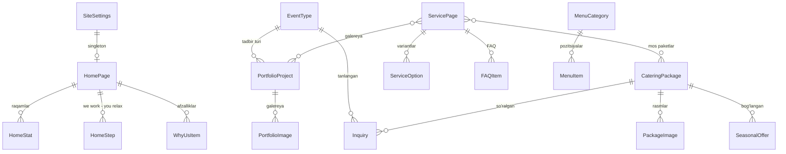

# 04 · Ma'lumotlar bazasi sxemasi

PostgreSQL. Tarjima qilinadigan maydonlar `*` bilan belgilangan. `django-modeltranslation` ular uchun `_en` va `_ru` ustunlarini yaratadi.

## ER diagramma

## Jadvallar

### Umumiy (abstract) mixinlar
- **TimeStamped:** `created_at`, `updated_at`
- **Publishable:** `is_published` (bool), `order` (int)
- **SEOFields:** `seo_title*`, `seo_description*`, `og_image`, `noindex` (bool)

### core
| Model | Maydonlar |
|---|---|
| **SiteSettings** (singleton) | company_name, phone, whatsapp_number, whatsapp_default_text*, email, instagram_url, service_area*, working_hours*, notify_emails, telegram_chat_id, logo, default_og_image, default_seo_title*, default_seo_description* |
| **HomePage** (singleton) + SEO | hero_title*, hero_subtitle*, hero_image, hero_video, hero_video_poster, cta_primary*, about_title*, about_text*, relax_title*, relax_text*, featured_packages_mode (auto/manual), featured_packages (M2M), featured_projects (M2M) |
| **HomeStat** | home (FK), value ("200+"), label*, order |
| **HomeStep** | home (FK), image, title*, text*, order |
| **WhyUsItem** | home (FK), icon, title*, text*, order |
| **AdditionalService** + Publishable | title*, description*, icon, provider (`own`/`partner`, faqat adminda) |
| **FAQItem** + Publishable | question*, answer*, placement (`home`/`service`/`partners`), service_page (FK, null) |
| **PartnersPage** (singleton) + SEO | title*, intro*, audience* (ro'yxat), offer_text* |
| **LegalPage** + SEO | slug (`privacy`), title*, body* |

### services
| Model | Maydonlar |
|---|---|
| **EventType** + Publishable | name*, slug |
| **ServicePage** + Publishable + SEO | title*, slug, card_text*, hero_image, body* (rich text), show_on_home, location_type, packages (M2M CateringPackage), projects (M2M PortfolioProject) |
| **ServiceOption** | service (FK), title*, text*, order |

### catering
| Model | Maydonlar |
|---|---|
| **CateringPackage** + Publishable + SEO | name*, slug, guests_min, guests_max, short_text*, contents* (text, qatorlab), price_from (decimal, null), currency (`AED`), price_note*, badge (choices), is_featured |
| **PackageImage** | package (FK), image, alt*, order |
| **SeasonalOffer** + Publishable | title*, text*, image, price (null), starts_at, ends_at, cta_text*, package (FK, null) |
| **MenuCategory** + Publishable | name* |
| **MenuItem** + Publishable | category (FK), name*, description*, price (null), is_available |
| **MenuFile** (singleton) | pdf_en, pdf_ru, updated_at |

### portfolio
| Model | Maydonlar |
|---|---|
| **PortfolioProject** + Publishable + SEO | title*, slug, event_type (FK), location_type (`yacht`/`villa`/`office`/`home`/`desert`/`venue`), event_date, guests, description*, cover, video_file, video_url, is_featured |
| **PortfolioImage** | project (FK), image, alt*, order |

### leads
| Model | Maydonlar |
|---|---|
| **Inquiry** | name, phone, event_date (null), event_type (FK, null), guests (null), location_type, comment, package (FK, null), language, source_page, utm_source, utm_medium, utm_campaign, referrer, ip_hash, status (`new`/`contacted`/`won`/`lost`/`spam`), manager_note, created_at |
| **PartnerRequest** | name, company, field, phone, email, message, status, manager_note, created_at |

## Rasmlar bilan ishlash

- `ImageField` + signal: saqlanganda `media/<model>/<id>/` papkasida `-480.webp`, `-960.webp`, `-1600.webp`, `-2400.webp` va AVIF variantlar yaratiladi.
- API har bir rasm uchun `{ src, srcset, width, height, alt, blurDataURL }` qaytaradi. Kichik blur-placeholder bo'lgani uchun rasm yuklanayotganda sahifa "sakramaydi".
- Asl fayl saqlanadi (backup uchun), lekin saytda ishlatilmaydi.
- Video: yuklashda hajmi tekshiriladi (≤ 25 MB). Hero video oldindan qo'lda siqiladi (≤ 3–4 MB, 720p, ovozsiz).
