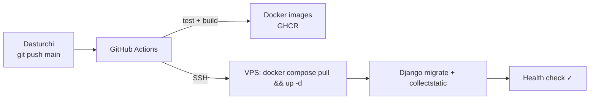

# 08 · Infratuzilma, deploy va yillik xarajatlar

> Romanning asosiy savoli: *«прошу примерно расписать обязательные ежегодные расходы... требует ли выбранная архитектура обязательного периодического технического обслуживания... как часто и сколько может стоить»*. Taqqoslash uchun: uning Tilda'dagi sayti yiliga **$15 + $71 ≈ $86** turadi.

## 1. Server

| Parametr | Qiymat |
|---|---|
| Provayder (taklif) | Hetzner Cloud yoki shunga o'xshash ishonchli VPS (yaqin data-markaz, ruxsat etilgan to'lov usuli bo'yicha tanlanadi) |
| Konfiguratsiya | 2 vCPU · 4 GB RAM · 40 GB SSD |
| OS | Ubuntu 24.04 LTS |
| Akkaunt egasi | **Roman / Rokate** (dasturchi alohida foydalanuvchi sifatida qo'shiladi) |

Konteynerlar (Docker Compose): `caddy`, `frontend` (Next.js), `backend` (Django + Gunicorn), `db` (PostgreSQL), `backup` (cron).

## 2. Deploy jarayoni

- GitHub repo **Roman nomidagi** akkaunt yoki organization'da bo'ladi.
- Deploy xatolik bilan tugasa, oldingi image saqlanib qoladi va bitta buyruq bilan orqaga qaytariladi.

## 3. Backup

| Nima | Qachon | Qayerga | Saqlash muddati |
|---|---|---|---|
| PostgreSQL dump | Har kecha | Cloudflare R2 (serverdan tashqari) | 14 kunlik + 8 haftalik |
| `media/` (rasmlar) | Har kecha (inkremental) | Cloudflare R2 | Doimiy |
| VPS snapshot | Ixtiyoriy (provayderda, pullik ~20%) | Provayder | — |

Tiklash bo'yicha qo'llanma (`docs/runbook`) kod bosqichida yoziladi. Topshirishdan oldin tiklash **bir marta sinab ko'riladi**.

## 4. Yillik xarajatlar (Romanga yuboriladigan qoralama)

⚠️ Narxlar taxminiy. Infratuzilma tanlanganda provayderlarning joriy narxlari tekshirib, yangilanadi.

### Majburiy

| Xizmat | Oyiga | Yiliga | Izoh |
|---|---|---|---|
| VPS server | ~€5–7 | **~€60–84** | Yozishmada aytilgan: ~€7/oy |
| Domen `.com` | — | **~$12–20** | `.ae` tanlansa ~$30–60/yil va trade license kerak |
| SSL sertifikat | — | **$0** | Let's Encrypt / Cloudflare, avtomatik yangilanadi |
| Cloudflare (DNS, CDN, himoya) | — | **$0** | Bepul tarif yetarli |
| Backup saqlash (Cloudflare R2) | — | **$0** | 10 GB gacha bepul |
| Google Analytics, Search Console | — | **$0** | |
| Arizalar bildirishnomasi (Telegram bot + email) | — | **$0** | |
| Litsenziyalar, pullik plaginlar | — | **$0** | Barcha komponentlar ochiq kodli |
| **JAMI majburiy** | | **≈ $80–110 / yil** | Tilda (~$86) bilan **deyarli bir xil** |

### Ixtiyoriy

| Xizmat | Narx | Qachon kerak |
|---|---|---|
| VPS snapshot / qo'shimcha backup | ~€1–2/oy | Qo'shimcha xotirjamlik uchun |
| Korporativ email (`info@domen`) | $0–4/oy | Agar kerak bo'lsa (Zoho, Google Workspace) |
| WhatsApp Business API bildirishnomalari | xabar boshiga pullik | Arizani WhatsApp'ga olish shart bo'lsa |
| Sentry (xatolar monitoringi) | $0 (bepul tarif) | — |
| Texnik xizmat (pastga qarang) | kelishiladi | — |

## 5. Texnik xizmat: aslida nima kerak?

| Ish | Qanchalik tez-tez | Kim | Vaqt |
|---|---|---|---|
| OS xavfsizlik yangilanishlari | Avtomatik (`unattended-upgrades`) | Hech kim | 0 |
| SSL yangilash | Avtomatik | Hech kim | 0 |
| Backup | Avtomatik + monitoring | Hech kim | 0 |
| Sayt ishlamay qolsa xabar | Avtomatik (UptimeRobot) | — | 0 |
| Django, Next.js va kutubxonalarning xavfsizlik yangilanishlari | Har 3–6 oyda | Dasturchi | ~1–2 soat |
| Django LTS versiyasini yangilash | Har ~2–3 yilda (5.2 LTS aprel 2028 gacha) | Dasturchi | ~3–6 soat |
| Kontent o'zgarishlari | Doimiy | **Roman o'zi**, admin orqali | — |

**Xulosa Roman uchun:** sayt "o'z-o'zidan" ishlaydi. Tilda'dan farqi: yiliga 2–4 marta yarim soatdan bir-ikki soatgacha texnik yangilash tavsiya etiladi. Buni bir martalik to'lov bilan yoki yillik paket sifatida kelishish mumkin. Majburiy emas, lekin xavfsizlik uchun to'g'ri.

> 💬 Narxni **siz** belgilaysiz. Masalan: "yangilash bir martada $X" yoki "yillik texnik xizmat $Y" (2–4 yangilash + kichik tuzatishlar).

## 6. Egalik va topshirish (checklist)

- [ ] Domen Roman nomida (registrator akkaunti uniki)
- [ ] VPS akkaunti Roman nomida, to'lov kartasi uniki
- [ ] Cloudflare akkaunti Roman nomida
- [ ] GitHub repo Roman nomida / organization'da
- [ ] GA4 va Search Console: Roman — Owner, dasturchi — Editor
- [ ] Barcha parollar va kalitlar xavfsiz usulda topshiriladi (masalan, Bitwarden Send)
- [ ] `.env` va kirish ma'lumotlari hujjatlashtirilgan
