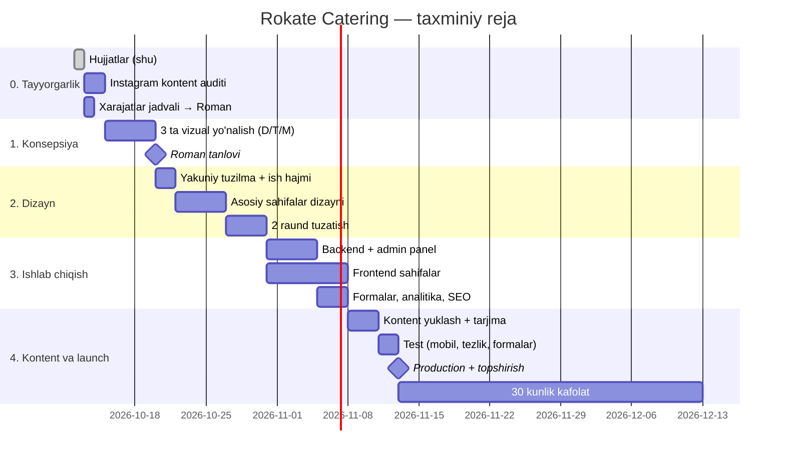

# 09 · Ish rejasi va bosqichlar

Muddatlar taxminiy va ish kunlarida hisoblangan. Roman yozganidek: *«качество для меня важнее запуска к конкретной дате»*.

## Bosqichlar tafsiloti

### 0. Tayyorgarlik (1–3 kun)
- [x] Loyiha hujjatlari (shu papka)
- [ ] Romanga **yillik xarajatlar jadvali** (08-hujjat asosida, RU tilida)
- [ ] Romanga **ochiq savollar** (00-hujjat, 6-bo'lim)
- [ ] Instagram akkauntini ko'rib chiqish: qaysi yo'nalishlar uchun kontent bor
- [ ] Materiallarni saralash ([10](10-kontent-va-materiallar.md))

### 1. Vizual konsepsiya (~5 kun)
- [ ] 3 ta yo'nalish: Premium Minimal, Editorial, Modern Dynamic
- [ ] Har biri: bosh sahifaning birinchi 3–4 ekrani, **desktop + tablet + mobile**
- [ ] Haqiqiy Rokate suratlari bilan
- [ ] Romanga taqdimot: rasmlar va qisqa izoh (RU)
- **Natija:** Roman yo'nalishni tanlaydi

### 2. Yakuniy dizayn (~1.5–2 hafta)
- [ ] Yakuniy sitemap va sahifalar ro'yxati, $800 ga nima kirishi yozma qayd etiladi
- [ ] Barcha MVP sahifalari dizayni (mobile-first)
- [ ] 2 raund tuzatish
- **Natija:** dizayn tasdiqlandi. 50% oldindan to'lov shu nuqtagacha olingan bo'lishi kerak (shartni o'zingiz aniqlashtiring).

### 3. Ishlab chiqish (~2 hafta)
- [ ] Repo, Docker, CI/CD, staging
- [ ] Django modellari, admin panel (Unfold, tarjimalar, rasmlar)
- [ ] API
- [ ] Next.js: layout, barcha sahifalar, i18n
- [ ] Formalar + Turnstile + Telegram/email bildirishnomalar
- [ ] GA4 eventlari, SEO (meta, sitemap, schema, OG)
- [ ] Romanga staging'ni ko'rsatish

### 4. Kontent, test, launch (~1 hafta)
- [ ] Domen va VPS (Roman akkauntlarida), Cloudflare, SSL
- [ ] Roman materiallarini yuklash, EN/RU matnlar
- [ ] Test: iPhone/Android, Safari/Chrome, Lighthouse, formalar, WhatsApp havolalari
- [ ] Backup va tiklash testi
- [ ] Search Console + sitemap
- [ ] Admin bo'yicha qo'llanma (RU)
- [ ] Topshirish mezonlari bo'yicha tekshiruv ([00](00-TZ-xulosa.md#4-topshirish-mezonlari-oxirgi-50-to'lov-uchun)), keyin **qolgan 50%**

### 5. Kafolat (30 kun)
- Joriy funksional xatolari bepul tuzatiladi.
- Yangi funksiyalar va konsepsiya o'zgarishlari alohida kelishiladi.

## Ish hajmi chegarasi ($800 ichida)

**Kiradi:** 3 ta yo'nalish eskizi · tanlangan yo'nalishning yakuniy dizayni · MVP sahifalari ([02](02-sahifalar-va-tuzilma.md#3-1-bosqich-mvp-sahifalari)) · admin panel ([03](03-admin-panel.md)) · EN/RU · formalar · bildirishnomalar · SEO bazasi · GA4/GSC · deploy · backup · Roman materiallarini joylash · qo'llanma · 30 kun kafolat.

**Kirmaydi (alohida kelishiladi):** copywriting (yangi matnlar yozish) · professional tarjima (katta hajm) · fotosessiya yoki katta hajmdagi suratlarni qayta ishlash · video montaj · Google Business Profile boshqaruvi · reklama (Google Ads/Meta) · doimiy SEO prodvijeniye · 30 kundan keyingi texnik xizmat · yangi funksiyalar.

## Xavflar

| Xavf | Ehtimol | Choralar |
|---|---|---|
| Kontent (suratlar, matnlar) kechikadi | Yuqori | Instagram'dan o'zimiz tanlaymiz, Roman tasdiqlaydi. Matn qoralamalari bizdan. |
| $800 uchun hajm o'sib ketadi | O'rta | 2-bosqichda ish hajmini yozma qayd etish |
| AI rasmlar haqiqiy deb ko'rsatilib qolishi | O'rta | Romandan aniqlashtirish, shubhali rasmlarni ishlatmaslik |
| Yillik xarajatlar haqidagi e'tiroz | O'rta | Shaffof jadval, Tilda bilan taqqoslash |
| Logotip vektor formatda yo'q | O'rta | Romandan so'rash. Bo'lmasa, vektorlashtirish (alohida ish) |
